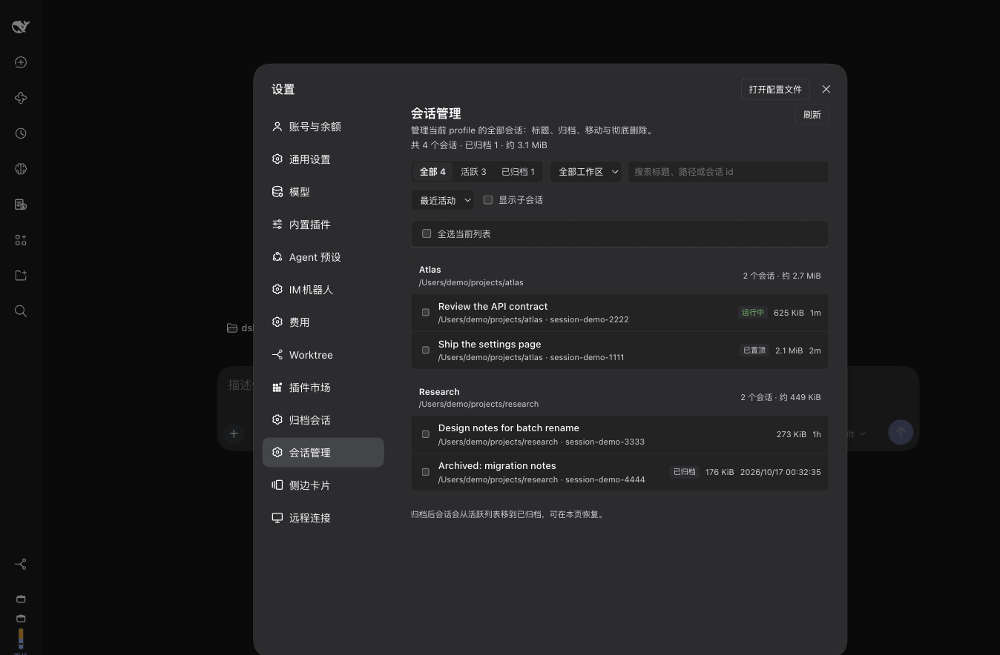
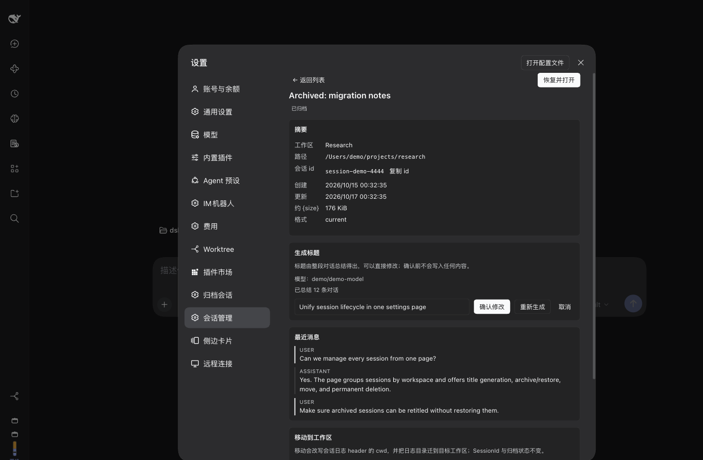
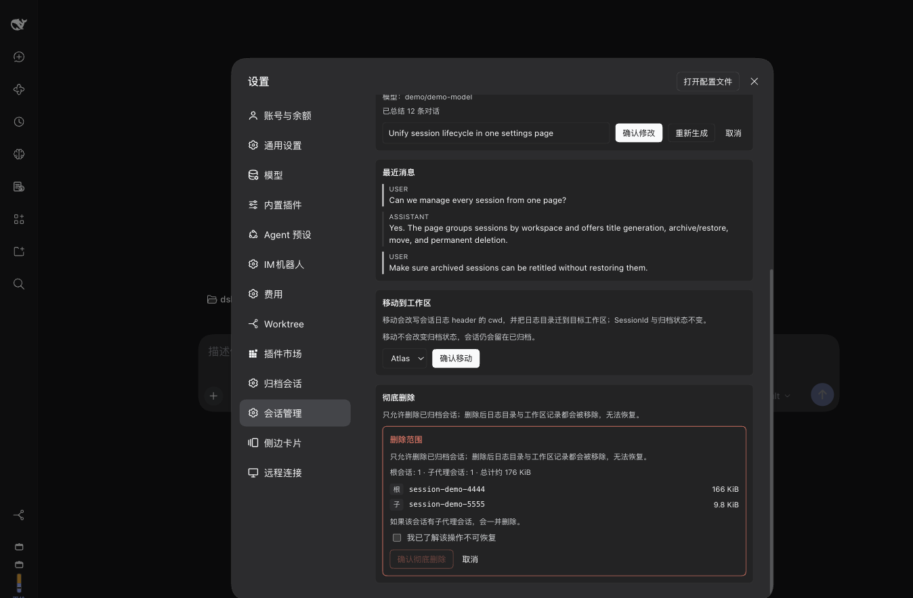

# dsh-session-mng

[](https://www.npmjs.com/package/dsh-session-mng)
[](https://github.com/deepseek-ai/deepseek-harness)
[](LICENSE)

**One Settings page for every DeepSeek Harness session — generate a title from the whole conversation, archive or restore, move a cold session to another workspace, and permanently delete archived sessions.**

一个设置页管理全部 DSH 会话：按整段对话生成标题、归档/恢复、跨工作区移动、彻底删除已归档会话。Host + Web Client 双半插件，无运行时依赖，不注册模型可见工具，不注册标题 provider。

> **Quick start (EN)** — Desktop app: install from the in-app **Plugins** page (the `desktop` profile is app-managed, so `dsh plugin --profile desktop …` refuses). CLI-managed profiles: `dsh plugin --profile <profile> add dsh-session-mng`. Open **Settings → Session Manager**. Nothing is written until you press a confirm button in a dialog.



## 功能

- **统一会话总览**：按工作区分组列出当前 profile 的全部会话（活跃 + 已归档）。显示标题、路径、会话 id、大小、最后活动时间、运行/已打开/已归档/已置顶/子会话标记；支持搜索、工作区筛选、排序、刷新、批量选择。
- **生成标题**：选中任意会话（**包括已归档的冷会话**），让模型总结整段对话，给出可编辑的标题提案；**确认后才写入**。活跃会话走官方 `sessionTitle.rename`，冷会话按官方 `session/title` 事件形状追加，不需要恢复会话。
- **归档 / 恢复**：调用官方 `workspaceRegistry.archiveSession` / `unarchiveSession`。运行中的会话先提示，用户二次确认后才停止并归档；恢复后回到原工作区原位置。
- **跨工作区移动**：把冷会话真正迁移到目标工作区——改写会话日志 header 的 `cwd`、把日志目录迁到目标项目目录、同步 workspace 账本。SessionId、归档状态、pin 状态不变，事件字节不变。
- **彻底删除已归档会话**：删除前先预览范围（根会话、子代理会话、目录、字节数）；确认后把日志目录移出 store、清理归档集合与 workspace 账本，再删除。**不可恢复。**
- **预览最近消息**：不恢复会话即可看最近 10 条用户/助手消息。
- **失效归档标记清理**：归档集合里有、但磁盘上已无日志的 id，会以横幅提示并允许清理。
- **中英双语**、浅色/深色主题跟随宿主。





## 安装

### 桌面版（DeepSeek Harness.app）

`desktop` profile 由应用独占，命令行不接管它。请在应用内 **设置 → 插件（Plugins）** 中搜索 `dsh-session-mng` 安装；安装后在 **设置 → 会话管理** 打开。

本地开发 / 未发 npm 时，在应用内插件管理器使用「从本地目录安装」，或在支持 `plugin_manager` 的会话里把本仓库目录作为 bundle 安装。

### 命令行管理的 profile（web / main / 自建）

```sh
# 从 npm 安装（发版后）
dsh plugin --profile <profile> add dsh-session-mng

# 从 GitHub 源码安装
dsh plugin --profile <profile> add github:ZilongYang/dsh-session-mng#main

# 本地开发：把本仓库直接链接进去
dsh plugin --profile <profile> add link:/绝对路径/dsh-session-mng
```

Host 半是进程内模块：装完如果看不到页面，重启一次 dsh/应用再刷新页面；Client 半刷新页面即可。

## 使用

1. 打开 **设置 → 会话管理**。
2. 顶部 tab 切换 全部 / 活跃 / 已归档；用工作区下拉、搜索框、排序缩小范围。
3. 点任意会话进入详情：生成标题、打开、归档/恢复并打开、移动到其他工作区、彻底删除（仅已归档）。
4. 在列表里勾选多个会话可批量归档、恢复、移动、删除；批量删除也会先显示范围确认。
5. 所有写操作都要在界面里明确点击确认；标题提案本身不写任何数据。

## 它是怎么工作的

```
Settings page (client.js)
      │  GET  /session-mng/api/state
      │  POST /session-mng/api/{preview,title/propose,title/apply,archive,unarchive,delete/preview,delete,move}
      ▼
Host route (lib/api.js) ──► service (lib/service.js)
      ├─ state        : sessionController/sessionQuery + workspaceRegistry + sessionPersistence
      ├─ title        : sessionQuery.readSurface → ctx.llm.stream → 确认后写 session/title 事件
      ├─ archive      : workspaceRegistry.archiveSession / unarchiveSession
      ├─ move         : 日志 header cwd 重写 + 目录迁移 + workspace 缓存对账（失败全回滚）
      └─ delete       : 删除范围预览 → 目录移入临时区 → 清理账本 → 删除（失败回滚）
```

- **标题是日志事件**：`session/title` 的 `source` 为 `user`，与官方重命名一致；已归档会话不需要恢复 Agent。
- **工作区归属是派生的**：由会话 header 的 `cwd` 决定。移动必须改写 header，只改账本无效。
- **不碰事件正文**：移动只重写日志第一个 frame（header），其余字节原样保留；移动后重新完整 replay 校验一次。
- **事务式删除/移动**：目录先移出 sessions root 到同文件系统的临时目录，失败可回滚；成功后才删除临时副本。
- **零模型工具**：不注册 agent tool、不注入系统提示词、不注册 title provider，正常对话的 token 开销为 0。

## 兼容性

| 项 | 说明 |
|---|---|
| 实测宿主 | DSH `0.2.1-rc.2`（Desktop `desktop` profile，Web GUI） |
| Node | `>=20.3` 可运行总览/标题/归档/删除；**移动** 需要 `node:zlib` 的 Zstandard 支持（Node `>=22.15`，当前 Desktop 运行时为 Node 24.21） |
| 会话后端 | 移动/删除只支持本地 JSONL 后端（`sessionPersistence.locate`）；其他后端仍可用总览/标题/归档/恢复 |
| 官方依赖 | 无 runtime 依赖；只使用 `ctx` 服务 |
| 已知限制 | 已打开（live）会话不能移动或彻底删除，重启 DSH 后重试；有子代理后代的会话不能单独移动；子会话不出现在主列表（可勾选「显示子会话」查看） |

### 版本敏感点（请读）

移动需要让 workspace registry 的内存 header 缓存先认识新 `cwd`，再走公开的 `attachSession` / `detachSession`。这个 seam 在当前实测版本可用，但属于宿主内部细节：

- 写盘前做特性检测；接口形状变化时直接拒绝移动并返回 `unsupported-registry`，不会留下半移动状态。
- 移动/删除都有回滚；极端情况下返回 `manual-recovery`，并在错误 details 中给出源目录、目标目录和备份目录。
- 兼容性只声明到实测版本；升级 DSH 后请先跑一遍 `npm test` 与本文的实机验收清单。

## 配置（可选）

在 profile 的 patch 行里可以覆盖默认值；所有值都会 clamp：

```yaml
- id: session-mng
  name: 'dsh-session-mng'
  config:
    maxBatch: 50            # 归档/恢复/删除单次最多 id 数
    maxMoveBatch: 20        # 移动单次最多 id 数
    titleTimeoutMs: 30000
    titleMaxInputBytes: 32768
    titleMaxOutputTokens: 256
    titleMaxBytes: 120
    allowRemote: false      # 默认只接受 loopback / webRuntime.trustedHosts
    sessionsRoot: ''        # 仅在 sessionPersistence.locate 缺失时作为定位兜底
```

## 安全边界

- API 路由默认只接受 loopback 或宿主 `webRuntime.trustedHosts`；拒绝 `Sec-Fetch-Site: cross-site` 与不匹配的 `Origin`。
- 请求体上限 64 KiB；只接受 host 已知的 session id 与 workspace id，不接受路径或命令参数。
- 不执行 shell 命令；文件操作只作用于 `sessionPersistence.locate` / 受控扫描推导出的会话目录。
- 日志只记录 action、session id、workspace id 和结果码，不记录标题、消息或路径全文。

## 开发

```sh
npm test                      # node --test，26 个单元/集成测试
node --check index.js client.js lib/*.js
npm --cache /tmp/dsh-npm-cache pack --dry-run
```

实机验收（详见 `docs/RELEASE-CHECKLIST-0.1.0.md`）：安装到 `desktop` profile → 确认 `settings.section` 出现 `session-mng-section` → 用**一次性测试会话**验证标题/归档/恢复/移动/删除 → 清理测试数据。

## 文档索引

- [实施计划（批准时原样归档）](docs/PLAN-2026-10-26.md)
- [0.1.0 发布检查清单](docs/RELEASE-CHECKLIST-0.1.0.md)
- [设计与实现说明](docs/01-design.md)
- [开源、发 npm 与市场收录记录](docs/02-open-source-and-marketplace.md)
- [路线图](ROADMAP.md)
- [变更记录](CHANGELOG.md)

## License

MIT © 2026 ZilongYang
